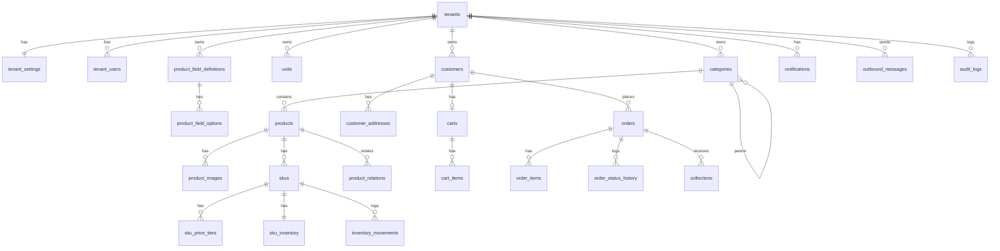

# BelGomla E-commerce — Domain Model (V1)

This document turns `01`–`06` into entities, tables, constraints and state machines. Every rule referenced as `BR-xxx` lives in `02-business-rules.md`.

Conventions:

- All ids are `bigint` identity. All tenant-owned tables carry `tenant_id bigint NOT NULL` with an index, and every unique constraint on business keys is composite with `tenant_id` (BR-T03).
- Money: `NUMERIC(12,2)`, EGP. Quantities: `integer`. Timestamps: `timestamptz` in UTC.
- `created_at` / `updated_at` exist on every table and are omitted below.
- Soft removal is a `status` value, never a `deleted_at`, because inactive rows must stay queryable for history (BR-P05).

---

## 1. Entity Map



---

## 2. Tenancy

### `tenants`

| Column    | Type         | Notes                                            |
| --------- | ------------ | ------------------------------------------------ |
| id        | bigint PK    |                                                  |
| subdomain | varchar(63)  | **unique**, lowercase, `[a-z0-9-]`               |
| name      | varchar(150) | Arabic store name                                |
| status    | enum         | `active`, `suspended` (BR-T07)                   |
| vertical  | varchar(30)  | `school-books`, `stationery`, `hardware`, `none` |

### `tenant_settings` (1:1 with tenants, `tenant_id` PK)

| Column                         | Type          | Notes                 |
| ------------------------------ | ------------- | --------------------- |
| logo_path, favicon_path        | varchar       | object storage keys   |
| primary_color, secondary_color | char(7)       | hex                   |
| phone, whatsapp                | varchar(20)   | E.164                 |
| address, description           | text          |                       |
| working_hours                  | jsonb         | `[{day, from, to}]`   |
| currency                       | char(3)       | always `EGP` in V1    |
| mov_enabled                    | boolean       | BR-MOV01              |
| mov_amount                     | numeric(12,2) | nullable              |
| require_login_for_prices       | boolean       | default false (D1)    |
| require_customer_approval      | boolean       | default false (D2)    |
| stale_pending_hours            | int           | default 24 (BR-INV07) |
| invitation_message             | text          | nullable; null = default text (BR-CU08, D72) |
| default_payment_terms_days     | smallint      | V2: nullable, 0–365, given to new customers (BR-C06) |
| default_credit_limit           | numeric(12,2) | V2: nullable, ≥ 0, given to new customers (BR-C05) |
| order_notify_statuses          | jsonb         | V2: list of statuses customers are told about, plus `discount` (D85) and `edited` (D87); default `["confirmed","out_for_delivery","delivered","cancelled","edited"]` (BR-N03) |
| order_status_messages          | jsonb         | V2: nullable map status → merchant wording; a missing entry = platform default (BR-N03) |
| pending_expiry_hours           | smallint      | V2: nullable = off; CHECK 1–720; unconfirmed orders cancel themselves after it (BR-INV07, D81) |
| max_discount_percent_sales     | numeric(5,2)  | V2 Task 08: nullable = sales users cannot discount; CHECK > 0 and < 100 (BR-PR08, D85) |

### `tenant_users`

| Column        | Type         | Notes                         |
| ------------- | ------------ | ----------------------------- |
| id            | bigint PK    |                               |
| tenant_id     | FK           |                               |
| name          | varchar(100) |                               |
| email         | varchar(190) | **unique (tenant_id, email)** |
| password_hash | varchar      |                               |
| role          | enum         | `owner`, `manager`, `sales`, `warehouse`, `accountant`; CHECK (V2, BR-T06, D82) |
| status        | enum         | `active`, `disabled`          |
| last_login_at | timestamptz  |                               |

---

## 3. Catalog

### `categories`

| Column     | Type         | Notes                                                   |
| ---------- | ------------ | ------------------------------------------------------- |
| id         | bigint PK    |                                                         |
| tenant_id  | FK           |                                                         |
| parent_id  | FK self      | nullable; **check parent_id <> id**; cycle check in app |
| name       | varchar(100) |                                                         |
| slug       | varchar(120) | **unique (tenant_id, slug)**                            |
| path       | varchar(500) | materialized `/1/7/23/`, rebuilt on move (Tech §9b)     |
| sort_order | int          |                                                         |
| image_path | varchar      | nullable                                                |
| kind       | varchar(20)  | `books`, `stationery`, `toys`, `general` (default); set on roots, copied to the subtree like `path` (D68) |
| icon       | varchar(40)  | nullable; `CategoryIcon` value for the storefront tile, null = guessed from the name (D73) |
| status     | enum         | `active`, `archived` (BR-P06)                           |

### `units`

| Column    | Type        | Notes                                 |
| --------- | ----------- | ------------------------------------- |
| id        | bigint PK   |                                       |
| tenant_id | FK          |                                       |
| name      | varchar(50) | **unique (tenant_id, name)** (BR-U01) |
| status    | enum        | `active`, `archived`                  |

### `product_field_definitions` (BR-P08)

| Column             | Type         | Notes                                   |
| ------------------ | ------------ | --------------------------------------- |
| id                 | bigint PK    |                                         |
| tenant_id          | FK           |                                         |
| key                | varchar(50)  | **unique (tenant_id, key)**, snake_case |
| label              | varchar(100) | Arabic                                  |
| type               | enum         | `text`, `number`, `select`, `boolean`   |
| is_required        | boolean      |                                         |
| show_on_storefront | boolean      |                                         |
| is_filterable      | boolean      | app check: only for `select`/`boolean`  |
| kind               | varchar(20)  | nullable; the section the field applies to, null = every section (D69) |
| filter_order       | int          | facet order on storefront               |
| sort_order         | int          | order on product page / form            |
| status             | enum         | `active`, `archived`                    |

### `product_field_options`

| Column        | Type         | Notes                             |
| ------------- | ------------ | --------------------------------- |
| id            | bigint PK    |                                   |
| tenant_id     | FK           |                                   |
| definition_id | FK           |                                   |
| label         | varchar(100) | **unique (definition_id, label)** |
| sort_order    | int          |                                   |
| status        | enum         | `active`, `archived`              |

### `products`

| Column        | Type            | Notes                                                                                                   |
| ------------- | --------------- | ------------------------------------------------------------------------------------------------------- |
| id            | bigint PK       |                                                                                                         |
| tenant_id     | FK              |                                                                                                         |
| category_id   | FK              |                                                                                                         |
| name          | varchar(200)    |                                                                                                         |
| slug          | varchar(220)    | **unique (tenant_id, slug)**                                                                            |
| description   | text            | nullable                                                                                                |
| status        | enum            | `active`, `coming_soon`, `inactive` (BR-P04)                                                            |
| custom_fields | jsonb           | `{ "grade": 12, "subject": 40, "brand": "..." }` — select values store the **option id**; **GIN index** |
| created_by    | FK tenant_users | nullable (seeded)                                                                                       |
| preorder_enabled | boolean      | V2 Task 10: default false; a Coming Soon product takes pre-orders (BR-P04, BR-O14, D88)                  |
| expected_at   | date            | V2 Task 10: nullable; the day the product is expected, shown on the storefront                          |
| preorder_limit | int            | V2 Task 10: nullable, **check ≥ 1**; cap in selling units over every open pre-order (null = none)       |

Search: `pg_trgm` GIN index on `name`; option labels are joined at query time for search (BR-P08).

### `product_images`

| Column     | Type      | Notes                                      |
| ---------- | --------- | ------------------------------------------ |
| id         | bigint PK |                                            |
| tenant_id  | FK        |                                            |
| product_id | FK        |                                            |
| path       | varchar   | object storage key                         |
| is_main    | boolean   | partial unique index: one main per product |
| sort_order | int       |                                            |

### `product_relations` (BR-P10)

| Column             | Type      | Notes                                             |
| ------------------ | --------- | ------------------------------------------------- |
| id                 | bigint PK |                                                   |
| tenant_id          | FK        |                                                   |
| product_id         | FK        |                                                   |
| related_product_id | FK        | **check <> product_id**                           |
| type               | enum      | `revision_of`, `companion`                        |
| —                  |           | **unique (product_id, related_product_id, type)** |

### `skus` (BR-P02, BR-U02, BR-PR01, BR-PR10)

| Column             | Type          | Notes                                                 |
| ------------------ | ------------- | ----------------------------------------------------- |
| id                 | bigint PK     |                                                       |
| tenant_id          | FK            |                                                       |
| product_id         | FK            |                                                       |
| code               | varchar(60)   | **unique (tenant_id, code)** (BR-P03)                 |
| name               | varchar(200)  | nullable; V1 = product name                           |
| selling_unit_id    | FK units      | BR-U02                                                |
| base_unit_id       | FK units      |                                                       |
| conversion_factor  | int           | **check ≥ 1**; base units per selling unit            |
| cover_price        | numeric(12,2) | nullable; the reference price: سعر الغلاف for `books`, سعر القطاعي otherwise (D68) |
| base_price         | numeric(12,2) | **check > 0**, per selling unit                       |
| base_price_percent | numeric(5,2)  | nullable; % off cover price used to derive base_price |
| moq                | int           | **check ≥ 1**, default 1 (BR-MOQ01)                   |

V1 invariant (app-enforced): exactly one SKU per product. V2 lifts it.

### `imports` (V2 Task 06)

One run of the catalog import (model `Catalog\Models\CatalogImport`).

| Column      | Type         | Notes                                                                 |
| ----------- | ------------ | --------------------------------------------------------------------- |
| id          | bigint PK    |                                                                       |
| tenant_id   | FK           |                                                                       |
| uuid        | uuid         | the preview token of the uploaded file; **unique (tenant_id, uuid)** (one run per token) |
| file_name   | varchar(255) | as uploaded                                                           |
| status      | varchar(20)  | **check** `queued`, `running`, `done`, `failed`                       |
| total       | int          | data rows of the file (counted when the run starts)                   |
| processed   | int          | rows read so far (progress)                                           |
| created / updated / skipped / failed | int | **check ≥ 0**; skipped = rows with errors, failed = rows the database refused unexpectedly |
| errors      | jsonb        | the first 500 `{ row, column, label, message }` (row 0 = the whole file) |
| batch_id    | uuid         | the audit batch of every change of the run                            |
| created_by  | FK tenant_users | nullable                                                          |
| started_at / finished_at | timestamp | nullable                                                |

The uploaded file waits in `storage/app/private/imports/{tenant}/{uuid}.{xlsx|csv}` for 24 h; queued exports are written to `.../exports/{tenant}/`.

---

## 4. Pricing

### `sku_price_tiers` (BR-PR03..05)

| Column           | Type          | Notes                                            |
| ---------------- | ------------- | ------------------------------------------------ |
| id               | bigint PK     |                                                  |
| tenant_id        | FK            |                                                  |
| sku_id           | FK            |                                                  |
| min_quantity     | int           | **check ≥ 1**; **unique (sku_id, min_quantity)** |
| unit_price       | numeric(12,2) | **check > 0**                                    |
| discount_percent | numeric(5,2)  | nullable, **check > 0 and < 100**, display only  |

**Price resolution** (pure function, used by cart display and checkout):

```
resolve(sku, qty, context = null):          # context: the customer's group % and negotiated prices (V2 Task 11)
                                             #          + the live promotion of each SKU priced (V2 Task 12)
  if context has a negotiated price for sku: return it            (source customer, BR-PR13)
  tier = max(min_quantity) among tiers where min_quantity <= qty
  normal = tier ? tier.unit_price : sku.base_price               (source tier | base, BR-PR04)
  group = context.group% ? round_half_up(sku.base_price × (100 − group%) / 100) : null
  promo = context.promotion(sku) ? round_half_up(sku.base_price × (100 − promo%) / 100) : null
  return the lowest of normal, group, promo (ties: that order)   (source group | promotion, BR-PR12, BR-PR15)
```

### `customer_groups` (V2 Task 11, BR-PR12, D89)

| Column           | Type          | Notes                                            |
| ---------------- | ------------- | ------------------------------------------------ |
| id               | bigint PK     |                                                  |
| tenant_id        | FK            | **unique (tenant_id, name)**                     |
| name             | varchar(100)  |                                                  |
| discount_percent | numeric(5,2)  | default 0, **check 0–90**; % off the base price  |
| status           | varchar(10)   | `active` \| `archived` (check); archived = no discount, members keep it |
| sort_order       | int           | default 0                                        |

### `customer_sku_prices` (V2 Task 11, BR-PR13, D89)

| Column      | Type          | Notes                                              |
| ----------- | ------------- | -------------------------------------------------- |
| id          | bigint PK     |                                                    |
| tenant_id   | FK            | index (tenant_id, sku_id)                          |
| customer_id | FK            | **unique (customer_id, sku_id)**                   |
| sku_id      | FK            |                                                    |
| unit_price  | numeric(12,2) | **check > 0**; in the selling unit, may be above the normal price |
| note        | varchar(300)  | nullable                                           |

---

### `promotions` (V2 Task 12, BR-PR15, D90)

| Column           | Type          | Notes                                            |
| ---------------- | ------------- | ------------------------------------------------ |
| id               | bigint PK     |                                                  |
| tenant_id        | FK            | index (tenant_id, status, ends_at)               |
| name             | varchar(100)  |                                                  |
| discount_percent | numeric(5,2)  | **check > 0 and < 90**; % off the base price     |
| starts_at        | timestamp     | UTC, like every timestamp here                   |
| ends_at          | timestamp     | **check ends_at > starts_at**                    |
| filter           | jsonb         | nullable; the dashboard product filter `{category, f, q, status}`; null = an explicit SKU list |
| status           | varchar(10)   | `draft` \| `scheduled` \| `active` \| `ended` \| `cancelled` (check); scheduled → active → ended moved by `pricing:promotions-tick`; prices read the times, not this column |
| created_by       | FK tenant_users | nullable                                       |
| cancelled_at     | timestamp     | nullable                                         |

### `promotion_skus` (V2 Task 12)

| Column       | Type   | Notes                                                        |
| ------------ | ------ | ------------------------------------------------------------ |
| promotion_id | FK     | cascade on delete; **PK (promotion_id, sku_id)**             |
| sku_id       | FK     | index (sku_id); the SKUs the filter or list selected when the promotion was last saved |

## 5. Inventory

### `sku_inventory` (1:1 with skus, `sku_id` PK)

| Column    | Type | Notes                                            |
| --------- | ---- | ------------------------------------------------ |
| tenant_id | FK   |                                                  |
| on_hand   | int  | base units, **check ≥ 0**                        |
| reserved  | int  | base units, **check ≥ 0 and reserved ≤ on_hand** |

`available = on_hand - reserved` (computed, BR-INV02). This row is the lock target in checkout (`SELECT … FOR UPDATE`).

The `reserved ≤ on_hand` check is deliberate: an adjustment that would drop On Hand below the reserved quantity is rejected, and the dashboard explains which open orders hold the reservation (BR-INV08). The API returns the list of those orders in the error payload so the UI can link to them.

### `inventory_movements` (BR-INV06)

| Column        | Type         | Notes                                                                                         |
| ------------- | ------------ | --------------------------------------------------------------------------------------------- |
| id            | bigint PK    |                                                                                               |
| tenant_id     | FK           |                                                                                               |
| sku_id        | FK           |                                                                                               |
| type          | enum         | `opening`, `adjustment`, `sale`, `return` (V2: a customer return, BR-R03/R06)                 |
| quantity      | int          | signed, base units (`sale` and a voided `return` are negative)                                |
| on_hand_after | int          | snapshot for traceability                                                                     |
| order_id      | FK           | nullable; set for `sale` and `return`                                                         |
| reason        | varchar(200) | required for `adjustment`                                                                     |
| actor_type    | enum         | `tenant_user`, `system`                                                                       |
| actor_id      | bigint       | nullable                                                                                      |

Reservation changes are **not** movements (BR-INV06).

---

## 6. Customers

### `customers`

| Column            | Type            | Notes                                                                                |
| ----------------- | --------------- | ------------------------------------------------------------------------------------ |
| id                | bigint PK       |                                                                                      |
| tenant_id         | FK              |                                                                                      |
| name              | varchar(150)    |                                                                                      |
| phone             | varchar(20)     | E.164 (`+20…`); **unique (tenant_id, phone)** (BR-CU04)                              |
| password          | varchar         | bcrypt hash; nullable until activated (named like `tenant_users.password`)           |
| remember_token    | varchar(100)    | nullable; rotated on password reset                                                  |
| status            | enum            | `pending_verification`, `invited`, `pending_approval`, `active`, `blocked` (BR-CU05) |
| phone_verified_at | timestamptz     | nullable                                                                             |
| created_by        | FK tenant_users | nullable; set when merchant-created (BR-CU08)                                        |
| approved_by       | FK tenant_users | nullable                                                                             |
| blocked_at        | timestamptz     | nullable (BR-CU05)                                                                   |
| blocked_reason    | varchar(300)    | nullable; the merchant's reason                                                     |
| status_before_block | enum          | nullable; restored on unblock (07 §11)                                               |
| credit_limit      | numeric(12,2)   | V2: nullable = no limit, check ≥ 0 (BR-C05)                                           |
| payment_terms_days | smallint       | V2: nullable = due on delivery, check 0–365 (BR-C06)                                  |
| order_notifications_opt_out | boolean | V2: default false; true = no order status messages (BR-N03)                     |
| customer_group_id | FK customer_groups | V2 Task 11: nullable; the customer's wholesale level (BR-PR12), kept when the group is archived |

### `customer_addresses` (BR-CU03)

| Column       | Type         | Notes                                    |
| ------------ | ------------ | ---------------------------------------- |
| id           | bigint PK    |                                          |
| tenant_id    | FK           |                                          |
| customer_id  | FK           |                                          |
| label        | varchar(50)  | "المحل", "المخزن"                        |
| governorate  | varchar(50)  |                                          |
| city         | varchar(80)  |                                          |
| address_line | varchar(300) |                                          |
| landmark     | varchar(200) | nullable                                 |
| phone        | varchar(20)  | nullable, defaults to customer phone     |
| is_default   | boolean      | partial unique `WHERE is_default AND status = 'active'`: one active default per customer; the oldest active address takes over when the default is archived |
| status       | enum         | `active` (default), `archived`           |

### `customer_otps` (BR-CU07)

| Column      | Type        | Notes                        |
| ----------- | ----------- | ---------------------------- |
| id          | bigint PK   |                              |
| tenant_id   | FK          |                              |
| phone       | varchar(20) |                              |
| purpose     | enum        | `register`, `password_reset` |
| code_hash   | varchar     | HMAC-SHA256 with the app key; never the plain code (a plain hash of 6 digits is reversible) |
| channel     | enum        | `whatsapp`, `sms`            |
| expires_at  | timestamptz | now + 10 min                 |
| attempts    | smallint    | max 5                        |
| consumed_at | timestamptz | nullable                     |

Rate limiting (5 sends / phone / hour) is enforced in Redis, not in this table. A new code marks the earlier live ones of the same phone and purpose as consumed.

### `customer_invitations` (BR-CU08)

| Column       | Type        | Notes        |
| ------------ | ----------- | ------------ |
| id           | bigint PK   |              |
| tenant_id    | FK          |              |
| customer_id  | FK          | **unique**: one row per customer; a re-send rotates the token |
| token_hash   | varchar     | sha256 of the 40-char token, **unique** |
| expires_at   | timestamptz | now + 7 days |
| used_at      | timestamptz | nullable     |
| sent_count   | smallint    |              |
| last_sent_at | timestamptz |              |

### `carts` / `cart_items` (BR-CU06)

`carts`: `id, tenant_id, customer_id` with **unique (customer_id)**.

`cart_items`: `id, tenant_id, cart_id, sku_id, quantity (check ≥ 1), kind varchar(10) default 'order' (check `order` | `preorder`, V2 Task 10)` with **unique (cart_id, sku_id, kind)** (was (cart_id, sku_id) before V2 Task 10). No prices are stored in the cart; they are resolved on read (BR-PR06). Pre-order lines (BR-O14) are confirmed apart from the order lines.

---

## 7. Orders

### `orders`

| Column                                              | Type          | Notes                                                                             |
| --------------------------------------------------- | ------------- | --------------------------------------------------------------------------------- |
| id                                                  | bigint PK     |                                                                                   |
| tenant_id                                           | FK            |                                                                                   |
| number                                              | int           | per-tenant sequence; **unique (tenant_id, number)** (BR-O09)                      |
| customer_id                                         | FK            |                                                                                   |
| status                                              | enum          | `pending`, `confirmed`, `preparing`, `out_for_delivery`, `delivered`, `cancelled` |
| items_total                                         | numeric(12,2) | Σ line_total                                                                      |
| discount_type                                       | varchar(8)    | V2 Task 08: `amount` or `percent`, null = no order discount (BR-PR08, D85)        |
| discount_value                                      | numeric(12,2) | nullable; EGP off or % off the items total; set with the type                     |
| discount_amount                                     | numeric(12,2) | default 0; what the order discount takes off; **check 0 ≤ discount_amount ≤ items_total**, 0 without a type |
| discount_reason                                     | varchar(300)  | nullable; required with an order discount (dashboard only)                         |
| order_total                                         | numeric(12,2) | = items_total − discount_amount, **CHECK** (BR-O08; = items_total in V1)          |
| returned_total                                      | numeric(12,2) | V2: Σ live returns, default 0, **check 0 ≤ returned_total ≤ order_total** (BR-R04) |
| collected_amount                                    | numeric(12,2) | denormalized Σ non-voided collections, default 0                                  |
| collection_status                                   | enum          | `unpaid`, `partially_collected`, `collected` (derived, BR-C03)                    |
| delivery_name                                       | varchar(150)  | snapshot (BR-O10)                                                                 |
| delivery_phone                                      | varchar(20)   | snapshot                                                                          |
| delivery_address                                    | jsonb         | snapshot of the chosen address                                                    |
| customer_note                                       | text          | nullable                                                                          |
| cancel_reason                                       | varchar(300)  | nullable                                                                          |
| cancelled_by_type                                   | enum          | `customer`, `tenant_user`, `system` (V2 expiry, D81), nullable                    |
| placed_at, confirmed_at, delivered_at, cancelled_at | timestamptz   | nullable except placed_at                                                         |
| due_at                                              | timestamptz   | V2: set on delivery = delivered_at + the customer's terms (BR-C06)                |
| placed_by_type                                      | varchar(12)   | V2 Task 07: `customer` (default) or `tenant_user` (BR-O11); CHECK on the two values |
| placed_by_id                                        | bigint        | nullable; the customer or dashboard user id, by `placed_by_type` (backfilled with `customer_id`) |
| kind                                                | varchar(10)   | V2 Task 10: `order` (default) or `preorder` (BR-O14, D88), CHECK                    |
| converted_from_id                                   | FK orders     | V2 Task 10: nullable; the pre-order a normal order was converted from; **check** only on `kind = order`; indexed |
| converted_at                                        | timestamptz   | V2 Task 10: nullable; a pre-order with nothing left to convert (state `converted`); **check** only on `kind = preorder` |

### `tenant_order_counters` (`tenant_id` PK, `next_number int`)

Incremented under row lock inside the checkout transaction; the row is created on a tenant's first order.

Foreign keys from `orders.customer_id`, `order_items.sku_id/product_id` and `inventory_movements.order_id` are `NO ACTION` (rows are never deleted; a tenant delete cascades through them in one statement). CHECKs: status and collection status values, `quantity ≥ 1`, `quantity_base = quantity × conversion_factor`.

### `order_items` (BR-PR07)

| Column            | Type          | Notes                                  |
| ----------------- | ------------- | -------------------------------------- |
| id                | bigint PK     |                                        |
| tenant_id         | FK            |                                        |
| order_id          | FK            |                                        |
| sku_id            | FK            | reference only; never used to re-price |
| product_id        | FK            | reference only                         |
| product_name      | varchar(200)  | snapshot                               |
| sku_code          | varchar(60)   | snapshot                               |
| sku_name          | varchar(200)  | snapshot                               |
| unit_name         | varchar(50)   | snapshot of selling unit               |
| conversion_factor | int           | snapshot                               |
| quantity          | int           | selling units, **check ≥ 1**           |
| quantity_base     | int           | = quantity × conversion_factor         |
| cover_price       | numeric(12,2) | snapshot, nullable                     |
| list_unit_price   | numeric(12,2) | V2 Task 08: the price before the manual discount (backfilled from unit_price) |
| manual_discount_type | varchar(8) | V2 Task 08: `amount` or `percent` per unit, null = none (BR-PR08) |
| manual_discount_value | numeric(12,2) | nullable, > 0, set with the type    |
| unit_price        | numeric(12,2) | applied price = list_unit_price less the manual discount; **check 0.01 ≤ unit_price ≤ list_unit_price**, = list_unit_price without a discount |
| discount_percent  | numeric(5,2)  | nullable, **display only**: the tier margin off the cover price (BR-PR10), not the manual discount |
| tier_min_quantity | int           | nullable; which tier applied           |
| price_source      | varchar(10)   | V2 Task 11: `base` \| `tier` \| `group` \| `customer` \| `promotion` (V2 Task 12) (check), where the list price came from (BR-PR14, BR-PR15); backfilled `tier` / `base` |
| promotion_id      | FK promotions | V2 Task 12: nullable; the promotion that set the list price (set exactly when `price_source = promotion`, check) |
| line_total        | numeric(12,2) | = quantity × unit_price; once delivered = delivered_quantity × unit_price (BR-O13) |
| delivered_quantity | int          | V2 Task 09: selling units that went out, set on delivery (backfilled = quantity for orders delivered before); **check 0 ≤ delivered_quantity ≤ quantity**; null until delivered (BR-O13) |
| removed_at        | timestamp     | V2 Task 09: the merchant removed the line (BR-O12); kept for history, out of totals, stock moves and returns; **check** a removed line has no delivered_quantity |
| reserved          | boolean       | V2 Task 10: default true; false on a pre-order line, which holds no stock; transitions and cancel release reserved lines only (BR-O14) |
| converted_quantity | int          | V2 Task 10: default 0, **check 0 ≤ converted_quantity ≤ quantity** and 0 on a reserved line; selling units of a pre-order line already in a normal order; a pre-order line's line_total = unit_price × (quantity − converted_quantity) |

### `order_status_history` (BR-O04)

`id, tenant_id, order_id, from_status, to_status, actor_type (customer|tenant_user|system), actor_id, note, created_at`.

### `order_item_changes` (V2 Task 09, BR-O12, BR-O13)

`id, tenant_id, order_id FK, order_item_id FK nullable, change varchar(16) (added | removed | quantity | delivered_short | converted (V2 Task 10), CHECK), old_quantity int nullable, new_quantity int nullable, unit_price_before numeric(12,2) nullable, unit_price_after numeric(12,2) nullable, actor_id FK tenant_users nullable (null = system), created_at`. Append-only, index `(order_id, id)`. `added` has only the new quantity and price, `removed` only the old ones, `quantity` both, `delivered_short` the ordered (old) and delivered (new) quantities at the line's price, `converted` what was left to convert of a pre-order line before and after (the pre-order price before, the new order's price after). Written by `EditOrderLines`, `ApplyTransition` and `ConvertPreorders`; model `Orders\Models\OrderItemChange`. Shown as `changes[]` on both order details (the dashboard adds `actor_id`).

### `order_returns` (V2 Task 01, BR-R01..R06)

| Column        | Type            | Notes                                                    |
| ------------- | --------------- | -------------------------------------------------------- |
| id            | bigint PK       |                                                          |
| tenant_id     | FK              |                                                          |
| order_id      | FK              | a delivered order                                        |
| number        | int             | per order 1, 2, …; **unique (order_id, number)**         |
| total         | numeric(12,2)   | Σ line_total, **check > 0**                              |
| refund_amount | numeric(12,2)   | paid back (BR-R04), default 0, check ≥ 0                 |
| refund_method | varchar(10)     | `cash` or `credit` (BR-C07), null when nothing went back |
| reason        | varchar(300)    | required                                                 |
| returned_at   | timestamptz     | defaults to now, never in the future                     |
| recorded_by   | FK tenant_users | nullable (system)                                        |
| voided_at, void_reason, voided_by | | set together (BR-R06), never deleted                  |

No status: a return is live or voided. Model `Orders\Models\OrderReturn`.

### `order_return_items`

`id, tenant_id, order_return_id FK, order_item_id FK, quantity int (check ≥ 1), quantity_base int, unit_price numeric(12,2) (the line's snapshot, D74, less the order discount's share, D85), line_total numeric(12,2)` (the last return of an order absorbs the rounding). `quantity_base = quantity × order_items.conversion_factor` is kept by `RecordReturn`, since the factor lives on the order line. Model `OrderReturnItem`.

---

## 8. Collections

### `collections` (BR-C02)

| Column       | Type            | Notes             |
| ------------ | --------------- | ----------------- |
| id           | bigint PK       |                   |
| tenant_id    | FK              |                   |
| order_id     | FK              |                   |
| kind         | enum            | `payment` (default), `refund` (V2, BR-R04) |
| order_return_id | FK order_returns | set exactly for a refund (the return it pays back) |
| amount       | numeric(12,2)   | **check > 0**     |
| method       | enum            | `cash`, or `credit` (V2, BR-C07) |
| customer_credit_id | FK customer_credits | set exactly for method `credit`: the credit drawn from (payment) or created (refund) |
| collected_at | timestamptz     |                   |
| recorded_by  | FK tenant_users | nullable (system, e.g. a transition without a user) |
| note         | varchar(300)    | nullable          |
| voided_at    | timestamptz     | nullable          |
| void_reason  | varchar(300)    | nullable          |
| voided_by    | FK tenant_users | nullable          |

Invariant (app, inside a transaction with the order row locked): `Σ live payments − Σ live refunds ≤ net total` (order_total − returned_total), except transiently between voiding a return's refund and voiding the return (BR-R06). After every insert/void, `orders.collected_amount` and `collection_status` are recomputed (Orders' `ApplyCollectedAmount`, called by Collections' `RecordCollection` / `VoidCollection`). Model `Collections\Models\CashCollection` (named apart from Laravel's `Collection`). CHECKs: `amount > 0`, `method = 'cash'`, `kind in (payment, refund)`, `order_return_id` set iff `kind = refund`, `voided_at` and `void_reason` set together.

### `customer_credits` (V2 Task 02, BR-C07)

`id, tenant_id, customer_id FK, source_return_id FK order_returns (nullable), amount numeric(12,2) (check > 0), remaining numeric(12,2) (check 0 ≤ remaining ≤ amount), note varchar(300), created_by FK tenant_users, voided_at, void_reason, voided_by, timestamps`. Model `Collections\Models\CustomerCredit`. `remaining` changes only under the credit's row lock (ApplyCustomerCredit, VoidCollection).

---

## 9. Notifications and Messaging

### `notifications` (BR-N02)

`id, tenant_id, tenant_user_id (nullable = all owners), type (new_order|customer_cancelled|whatsapp_dropped|order_expired|new_preorder), data jsonb, read_at`. `new_preorder` (V2 Task 10): a customer's pre-order (BR-O14).

Our own table, not Laravel's notifications table; the model is `Orders\Models\MerchantNotification` (named apart from Laravel's `Notification`) and rows are written by the `NotifyMerchants` action inside the order transaction. A row for all owners has one shared `read_at` (D57). `whatsapp_dropped` (V2 Task 03) has no order: `data` holds `phone` and `reason`. `permission` varchar(40) (V2 Task 05, D82): who may see the row (`orders.manage` for order notifications, `settings.manage` for `whatsapp_dropped`).

### `outbound_messages` (Tech §13)

| Column              | Type         | Notes                                                                                       |
| ------------------- | ------------ | ------------------------------------------------------------------------------------------- |
| id                  | bigint PK    |                                                                                             |
| tenant_id           | FK           |                                                                                             |
| uuid                | uuid unique  | our reference; sent to Hypersender SMS as `request_id`                                      |
| to_phone            | varchar(20)  | E.164 (`App\Support\PhoneNumber`)                                                           |
| purpose             | enum         | `otp`, `invitation`, `system_alert`, `order_status` (V2, BR-N03)                            |
| order_id            | FK orders    | V2: nullable; the order an `order_status` message is about (order page message log)         |
| channel             | enum         | `whatsapp`, `sms`                                                                           |
| provider            | varchar(30)  | `hypersender` (platform number), `wa_gateway` (store number, D70), `meta_cloud` reserved, `log` (development) |
| provider_request_id | varchar      | nullable, indexed; Hypersender `queued_request_uuid` polled for the final result            |
| provider_message_id | varchar      | nullable, indexed; WhatsApp `key.id` / SMS message id                                       |
| status              | enum         | `queued`, `sent`, `delivered`, `failed`, `fell_back` (final: delivered, failed, fell_back) |
| error_code          | varchar(50)  | nullable; e.g. `not_on_whatsapp`, `poll_timeout`, `sms_failed`, `provider_unreachable`, `session_not_open`, `gateway_unreachable` |
| body                | text         | nullable, **encrypted**, never serialised; kept only until the SMS fallback can no longer be needed (cleared when final, or when an SMS is sent) |
| fallback_of_id      | FK self      | nullable, **unique**; the copy points at the failed row (store number → platform number → SMS, D70); CHECK: a copy never uses `wa_gateway` |
| cost                | numeric(8,4) | nullable (Hypersender reports no per-message cost)                                          |

`system_alert` rows are the operator alerts of `platform:monitor` (tasks/11, D65), logged under the tenant named by `MONITOR_ALERT_TENANT`.

### `whatsapp_connections` (D70, tasks/12)

The store's own WhatsApp number, linked by QR through `wa-gateway/`. One row per tenant.

| Column            | Type        | Notes                                                                          |
| ----------------- | ----------- | ------------------------------------------------------------------------------ |
| id                | bigint PK   |                                                                                |
| tenant_id         | FK unique   | one number per store                                                           |
| session_key       | uuid unique | the only id wa-gateway sees; replaced on every new pairing                     |
| status            | enum        | `pairing`, `connected`, `disconnected`, `logged_out`, `error`                  |
| phone             | varchar(20) | nullable, E.164; partial unique index where `status = connected` (one number, one store) |
| disconnect_reason | varchar(50) | nullable; gateway reason (`logged_out`, `qr_expired`, …) or `phone_in_use`      |
| connected_at      | timestamp   | nullable                                                                       |
| last_event_at     | timestamp   | nullable; last gateway event for this number                                   |

OTPs and invitations of a tenant with a `connected` row start on `wa_gateway`; everything else, and every fallback, uses the platform providers.

### `sms_phone_heartbeats` (platform, D49, tasks/11)

Not tenant-owned. One row per Hypersender SMS phone, upserted by every `phone.heartbeat.received` webhook; the monitor alerts after 2 hours without one.

| Column       | Type         | Notes                                           |
| ------------ | ------------ | ----------------------------------------------- |
| id           | bigint PK    |                                                 |
| phone_id     | varchar      | unique; Hypersender phone uuid                  |
| last_seen_at | timestamp    | when we received the last heartbeat (our clock) |

---

## 10. Audit

### `audit_logs` (BR-L)

| Column      | Type        | Notes                                              |
| ----------- | ----------- | -------------------------------------------------- |
| id          | bigint PK   |                                                    |
| tenant_id   | FK          |                                                    |
| actor_type  | enum        | `tenant_user`, `customer`, `system`                |
| actor_id    | bigint      | nullable                                           |
| action      | varchar(60) | `product.price_changed`, `order.status_changed`, … |
| entity_type | varchar(40) |                                                    |
| entity_id   | bigint      |                                                    |
| old_values  | jsonb       | nullable                                           |
| new_values  | jsonb       | nullable                                           |
| batch_id    | uuid        | nullable; groups one bulk action (BR-P12, BR-PR11) |
| ip          | inet        | nullable                                           |
| user_agent  | varchar     | nullable                                           |
| created_at  | timestamptz | append-only: no update/delete grants               |

---

## 11. State Machines

### Order status (BR-O01, BR-O02)

```
pending ──► confirmed ──► preparing ──► out_for_delivery ──► delivered
   │            │             │                │
   └────────────┴─────────────┴────────────────┴──► cancelled
```

- Forward moves may skip steps; backward moves are rejected.
- `cancelled` allowed from any non-terminal status. Customer only from `pending`.
- Guard on cancel: `collected_amount = 0` (BR-O03).
- Side effects (same transaction): `delivered` → inventory deduction + `sale` movement; `cancelled` → reservation release.
- A pre-order (`kind = preorder`, V2 Task 10) only goes `pending → cancelled` (it reserved nothing, so nothing is released), and not once it is converted in full (`converted_at`). Its derived state: `open` (pending, something left), `converted`, `cancelled` (D88).

### Collection status (derived)

```
collected_amount = 0            → unpaid
0 < collected_amount < total    → partially_collected
collected_amount ≥ total        → collected
```

### Customer status (BR-CU05)

```
self-register  → pending_verification ──OTP──► active            (approval off)
                                       ──OTP──► pending_approval ──merchant──► active (approval on)
merchant create → invited ──link used──► active (or pending_approval if approval on)
any            → blocked ──unblock──► previous status
```

### Product status

`active ⇄ inactive`, `coming_soon → active`, `coming_soon → inactive`.

---

## 12. Checkout Transaction (BR-PR06, BR-INV03, Tech §11)

```
BEGIN
  assert tenant.status = active
  assert customer.status = active
  load cart items; reject if empty
  lock sku_inventory rows FOR UPDATE (ordered by sku_id to avoid deadlocks)
  for each item:
    assert product.status = active                      → else error "المنتج غير متاح"
    unit_price = resolve(sku, qty)                      (section 4)
    assert qty ≥ sku.moq                                → "الحد الأدنى للطلب"
    qty_base = qty × conversion_factor
    assert available ≥ qty_base                         → "الكمية غير متوفرة"
    line_total = qty × unit_price
  items_total = Σ line_total
  if settings.mov_enabled: assert items_total ≥ mov_amount
  lock tenant_order_counters FOR UPDATE; number = next_number++
  insert orders (status = pending, snapshots)
  insert order_items (snapshots)
  update sku_inventory set reserved = reserved + qty_base
  insert order_status_history (null → pending)
  delete cart_items
  insert notification (new_order)
  insert audit_logs (order.created)
COMMIT
```

Any assertion failure rolls back and returns a 422 listing the offending SKU(s).

V2 Task 07: everything after loading the cart is `Orders\Actions\PlaceOrder`, shared with the merchant-placed order (BR-O11): the lines come from the merchant's form instead of the cart, the actor is the dashboard user, the MOV step may be waived (D84), the cart is not touched and no `new_order` notification is written. `POST /api/dashboard/orders/quote` runs the same checks on unlocked stock and writes nothing.

---

## 13. Indexes Worth Naming

| Table             | Index                                             | Purpose            |
| ----------------- | ------------------------------------------------- | ------------------ |
| products          | `(tenant_id, status, category_id)`                | listing            |
| products          | GIN `(custom_fields)`                             | facets             |
| products          | GIN trgm `(name)`                                 | search             |
| categories        | `(tenant_id, path varchar_pattern_ops)`           | descendants        |
| skus              | `(tenant_id, code)` unique                        | BR-P03             |
| orders            | `(tenant_id, status, placed_at desc)`             | dashboard lists    |
| orders            | `(tenant_id, customer_id, placed_at desc)`        | customer history   |
| orders            | `(tenant_id, collection_status)`                  | outstanding report |
| collections       | `(order_id) where voided_at is null`              | balance            |
| customers         | `(tenant_id, phone)` unique                       | login              |
| audit_logs        | `(tenant_id, entity_type, entity_id, created_at)` | entity timeline    |
| outbound_messages | `(tenant_id, to_phone, created_at)`               | rate-limit audit   |

---

## 14. Laravel Module Layout (Tech §17)

```
app/Modules/
  Tenancy/      tenants, settings, tenant_users, middleware, artisan commands
  Catalog/      categories, units, products, images, fields, relations, skus, verticals
  Pricing/      tiers, PriceResolver, BulkPricing
  Inventory/    sku_inventory, movements, ReservationService
  Customers/    customers, addresses, otp, invitations, carts
  Orders/       orders, items, history, CheckoutService, OrderStateMachine
  Collections/  collections, CollectionService
  Messaging/    Messenger, MessageDriver (Hypersender WhatsApp/SMS, Log), RecordDeliveryStatus, webhooks
  Notifications/
  Audit/
```

Each module exposes services; cross-module calls go through those services, never through another module's Eloquent models directly.

---

## 15. What This Model Deliberately Leaves Out (V2 hooks)

| V2 feature             | Hook already present                                   |
| ---------------------- | ------------------------------------------------------ |
| Variants               | products 1:N skus                                      |
| Multiple selling units | `selling_unit_id` on SKU → becomes a `sku_units` table |
| Roles                  | `tenant_users.role` enum                               |
| Pre-orders             | Built in V2 Task 10: `products.preorder_*`, `orders.kind` / `converted_from_id` / `converted_at`, `order_items.reserved` / `converted_quantity`, `cart_items.kind` (BR-O14, D88) |
| Order notifications    | `outbound_messages.purpose` enum                       |
