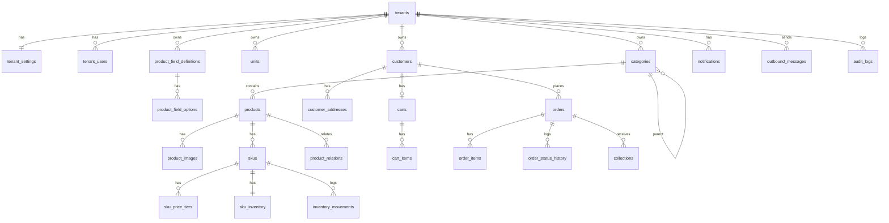

# BelGomla E-commerce — Domain Model (V1)

This document turns `01`–`06` into entities, tables, constraints and state machines. Every rule referenced as `BR-xxx` lives in `02-business-rules.md`.

Conventions:

- All ids are `bigint` identity. All tenant-owned tables carry `tenant_id bigint NOT NULL` with an index, and every unique constraint on business keys is composite with `tenant_id` (BR-T03).
- Money: `NUMERIC(12,2)`, EGP. Quantities: `integer`. Timestamps: `timestamptz` in UTC.
- `created_at` / `updated_at` exist on every table and are omitted below.
- Soft removal is a `status` value, never a `deleted_at`, because inactive rows must stay queryable for history (BR-P05).

---

## 1. Entity Map



---

## 2. Tenancy

### `tenants`

| Column    | Type         | Notes                                            |
| --------- | ------------ | ------------------------------------------------ |
| id        | bigint PK    |                                                  |
| subdomain | varchar(63)  | **unique**, lowercase, `[a-z0-9-]`               |
| name      | varchar(150) | Arabic store name                                |
| status    | enum         | `active`, `suspended` (BR-T07)                   |
| vertical  | varchar(30)  | `school-books`, `stationery`, `hardware`, `none` |

### `tenant_settings` (1:1 with tenants, `tenant_id` PK)

| Column                         | Type          | Notes                 |
| ------------------------------ | ------------- | --------------------- |
| logo_path, favicon_path        | varchar       | object storage keys   |
| primary_color, secondary_color | char(7)       | hex                   |
| phone, whatsapp                | varchar(20)   | E.164                 |
| address, description           | text          |                       |
| working_hours                  | jsonb         | `[{day, from, to}]`   |
| currency                       | char(3)       | always `EGP` in V1    |
| mov_enabled                    | boolean       | BR-MOV01              |
| mov_amount                     | numeric(12,2) | nullable              |
| require_login_for_prices       | boolean       | default false (D1)    |
| require_customer_approval      | boolean       | default false (D2)    |
| stale_pending_hours            | int           | default 24 (BR-INV07) |

### `tenant_users`

| Column        | Type         | Notes                         |
| ------------- | ------------ | ----------------------------- |
| id            | bigint PK    |                               |
| tenant_id     | FK           |                               |
| name          | varchar(100) |                               |
| email         | varchar(190) | **unique (tenant_id, email)** |
| password_hash | varchar      |                               |
| role          | enum         | `owner` only in V1 (BR-T06)   |
| status        | enum         | `active`, `disabled`          |
| last_login_at | timestamptz  |                               |

---

## 3. Catalog

### `categories`

| Column     | Type         | Notes                                                   |
| ---------- | ------------ | ------------------------------------------------------- |
| id         | bigint PK    |                                                         |
| tenant_id  | FK           |                                                         |
| parent_id  | FK self      | nullable; **check parent_id <> id**; cycle check in app |
| name       | varchar(100) |                                                         |
| slug       | varchar(120) | **unique (tenant_id, slug)**                            |
| path       | varchar(500) | materialized `/1/7/23/`, rebuilt on move (Tech §9b)     |
| sort_order | int          |                                                         |
| image_path | varchar      | nullable                                                |
| status     | enum         | `active`, `archived` (BR-P06)                           |

### `units`

| Column    | Type        | Notes                                 |
| --------- | ----------- | ------------------------------------- |
| id        | bigint PK   |                                       |
| tenant_id | FK          |                                       |
| name      | varchar(50) | **unique (tenant_id, name)** (BR-U01) |
| status    | enum        | `active`, `archived`                  |

### `product_field_definitions` (BR-P08)

| Column             | Type         | Notes                                   |
| ------------------ | ------------ | --------------------------------------- |
| id                 | bigint PK    |                                         |
| tenant_id          | FK           |                                         |
| key                | varchar(50)  | **unique (tenant_id, key)**, snake_case |
| label              | varchar(100) | Arabic                                  |
| type               | enum         | `text`, `number`, `select`, `boolean`   |
| is_required        | boolean      |                                         |
| show_on_storefront | boolean      |                                         |
| is_filterable      | boolean      | app check: only for `select`/`boolean`  |
| filter_order       | int          | facet order on storefront               |
| sort_order         | int          | order on product page / form            |
| status             | enum         | `active`, `archived`                    |

### `product_field_options`

| Column        | Type         | Notes                             |
| ------------- | ------------ | --------------------------------- |
| id            | bigint PK    |                                   |
| tenant_id     | FK           |                                   |
| definition_id | FK           |                                   |
| label         | varchar(100) | **unique (definition_id, label)** |
| sort_order    | int          |                                   |
| status        | enum         | `active`, `archived`              |

### `products`

| Column        | Type            | Notes                                                                                                   |
| ------------- | --------------- | ------------------------------------------------------------------------------------------------------- |
| id            | bigint PK       |                                                                                                         |
| tenant_id     | FK              |                                                                                                         |
| category_id   | FK              |                                                                                                         |
| name          | varchar(200)    |                                                                                                         |
| slug          | varchar(220)    | **unique (tenant_id, slug)**                                                                            |
| description   | text            | nullable                                                                                                |
| status        | enum            | `active`, `coming_soon`, `inactive` (BR-P04)                                                            |
| custom_fields | jsonb           | `{ "grade": 12, "subject": 40, "brand": "..." }` — select values store the **option id**; **GIN index** |
| created_by    | FK tenant_users | nullable (seeded)                                                                                       |

Search: `pg_trgm` GIN index on `name`; option labels are joined at query time for search (BR-P08).

### `product_images`

| Column     | Type      | Notes                                      |
| ---------- | --------- | ------------------------------------------ |
| id         | bigint PK |                                            |
| tenant_id  | FK        |                                            |
| product_id | FK        |                                            |
| path       | varchar   | object storage key                         |
| is_main    | boolean   | partial unique index: one main per product |
| sort_order | int       |                                            |

### `product_relations` (BR-P10)

| Column             | Type      | Notes                                             |
| ------------------ | --------- | ------------------------------------------------- |
| id                 | bigint PK |                                                   |
| tenant_id          | FK        |                                                   |
| product_id         | FK        |                                                   |
| related_product_id | FK        | **check <> product_id**                           |
| type               | enum      | `revision_of`, `companion`                        |
| —                  |           | **unique (product_id, related_product_id, type)** |

### `skus` (BR-P02, BR-U02, BR-PR01, BR-PR10)

| Column             | Type          | Notes                                                 |
| ------------------ | ------------- | ----------------------------------------------------- |
| id                 | bigint PK     |                                                       |
| tenant_id          | FK            |                                                       |
| product_id         | FK            |                                                       |
| code               | varchar(60)   | **unique (tenant_id, code)** (BR-P03)                 |
| name               | varchar(200)  | nullable; V1 = product name                           |
| selling_unit_id    | FK units      | BR-U02                                                |
| base_unit_id       | FK units      |                                                       |
| conversion_factor  | int           | **check ≥ 1**; base units per selling unit            |
| cover_price        | numeric(12,2) | nullable (سعر الغلاف)                                 |
| base_price         | numeric(12,2) | **check > 0**, per selling unit                       |
| base_price_percent | numeric(5,2)  | nullable; % off cover price used to derive base_price |
| moq                | int           | **check ≥ 1**, default 1 (BR-MOQ01)                   |

V1 invariant (app-enforced): exactly one SKU per product. V2 lifts it.

---

## 4. Pricing

### `sku_price_tiers` (BR-PR03..05)

| Column           | Type          | Notes                                            |
| ---------------- | ------------- | ------------------------------------------------ |
| id               | bigint PK     |                                                  |
| tenant_id        | FK            |                                                  |
| sku_id           | FK            |                                                  |
| min_quantity     | int           | **check ≥ 1**; **unique (sku_id, min_quantity)** |
| unit_price       | numeric(12,2) | **check > 0**                                    |
| discount_percent | numeric(5,2)  | nullable, **check > 0 and < 100**, display only  |

**Price resolution** (pure function, used by cart display and checkout):

```
resolve(sku, qty):
  tier = max(min_quantity) among tiers where min_quantity <= qty
  return tier ? tier.unit_price : sku.base_price
```

---

## 5. Inventory

### `sku_inventory` (1:1 with skus, `sku_id` PK)

| Column    | Type | Notes                                            |
| --------- | ---- | ------------------------------------------------ |
| tenant_id | FK   |                                                  |
| on_hand   | int  | base units, **check ≥ 0**                        |
| reserved  | int  | base units, **check ≥ 0 and reserved ≤ on_hand** |

`available = on_hand - reserved` (computed, BR-INV02). This row is the lock target in checkout (`SELECT … FOR UPDATE`).

The `reserved ≤ on_hand` check is deliberate: an adjustment that would drop On Hand below the reserved quantity is rejected, and the dashboard explains which open orders hold the reservation (BR-INV08). The API returns the list of those orders in the error payload so the UI can link to them.

### `inventory_movements` (BR-INV06)

| Column        | Type         | Notes                                                                                         |
| ------------- | ------------ | --------------------------------------------------------------------------------------------- |
| id            | bigint PK    |                                                                                               |
| tenant_id     | FK           |                                                                                               |
| sku_id        | FK           |                                                                                               |
| type          | enum         | `opening`, `adjustment`, `sale`, `return` (**`return` reserved for V2, never written in V1**) |
| quantity      | int          | signed, base units (`sale` is negative)                                                       |
| on_hand_after | int          | snapshot for traceability                                                                     |
| order_id      | FK           | nullable; set for `sale`                                                                      |
| reason        | varchar(200) | required for `adjustment`                                                                     |
| actor_type    | enum         | `tenant_user`, `system`                                                                       |
| actor_id      | bigint       | nullable                                                                                      |

Reservation changes are **not** movements (BR-INV06).

---

## 6. Customers

### `customers`

| Column            | Type            | Notes                                                                                |
| ----------------- | --------------- | ------------------------------------------------------------------------------------ |
| id                | bigint PK       |                                                                                      |
| tenant_id         | FK              |                                                                                      |
| name              | varchar(150)    |                                                                                      |
| phone             | varchar(20)     | E.164 (`+20…`); **unique (tenant_id, phone)** (BR-CU04)                              |
| password          | varchar         | bcrypt hash; nullable until activated (named like `tenant_users.password`)           |
| remember_token    | varchar(100)    | nullable; rotated on password reset                                                  |
| status            | enum            | `pending_verification`, `invited`, `pending_approval`, `active`, `blocked` (BR-CU05) |
| phone_verified_at | timestamptz     | nullable                                                                             |
| created_by        | FK tenant_users | nullable; set when merchant-created (BR-CU08)                                        |
| approved_by       | FK tenant_users | nullable                                                                             |
| blocked_at        | timestamptz     | nullable (BR-CU05)                                                                   |
| blocked_reason    | varchar(300)    | nullable; the merchant's reason                                                     |
| status_before_block | enum          | nullable; restored on unblock (07 §11)                                               |

### `customer_addresses` (BR-CU03)

| Column       | Type         | Notes                                    |
| ------------ | ------------ | ---------------------------------------- |
| id           | bigint PK    |                                          |
| tenant_id    | FK           |                                          |
| customer_id  | FK           |                                          |
| label        | varchar(50)  | "المحل", "المخزن"                        |
| governorate  | varchar(50)  |                                          |
| city         | varchar(80)  |                                          |
| address_line | varchar(300) |                                          |
| landmark     | varchar(200) | nullable                                 |
| phone        | varchar(20)  | nullable, defaults to customer phone     |
| is_default   | boolean      | partial unique `WHERE is_default AND status = 'active'`: one active default per customer; the oldest active address takes over when the default is archived |
| status       | enum         | `active` (default), `archived`           |

### `customer_otps` (BR-CU07)

| Column      | Type        | Notes                        |
| ----------- | ----------- | ---------------------------- |
| id          | bigint PK   |                              |
| tenant_id   | FK          |                              |
| phone       | varchar(20) |                              |
| purpose     | enum        | `register`, `password_reset` |
| code_hash   | varchar     | HMAC-SHA256 with the app key; never the plain code (a plain hash of 6 digits is reversible) |
| channel     | enum        | `whatsapp`, `sms`            |
| expires_at  | timestamptz | now + 10 min                 |
| attempts    | smallint    | max 5                        |
| consumed_at | timestamptz | nullable                     |

Rate limiting (5 sends / phone / hour) is enforced in Redis, not in this table. A new code marks the earlier live ones of the same phone and purpose as consumed.

### `customer_invitations` (BR-CU08)

| Column       | Type        | Notes        |
| ------------ | ----------- | ------------ |
| id           | bigint PK   |              |
| tenant_id    | FK          |              |
| customer_id  | FK          | **unique**: one row per customer; a re-send rotates the token |
| token_hash   | varchar     | sha256 of the 40-char token, **unique** |
| expires_at   | timestamptz | now + 7 days |
| used_at      | timestamptz | nullable     |
| sent_count   | smallint    |              |
| last_sent_at | timestamptz |              |

### `carts` / `cart_items` (BR-CU06)

`carts`: `id, tenant_id, customer_id` with **unique (customer_id)**.

`cart_items`: `id, tenant_id, cart_id, sku_id, quantity (check ≥ 1)` with **unique (cart_id, sku_id)**. No prices are stored in the cart; they are resolved on read (BR-PR06).

---

## 7. Orders

### `orders`

| Column                                              | Type          | Notes                                                                             |
| --------------------------------------------------- | ------------- | --------------------------------------------------------------------------------- |
| id                                                  | bigint PK     |                                                                                   |
| tenant_id                                           | FK            |                                                                                   |
| number                                              | int           | per-tenant sequence; **unique (tenant_id, number)** (BR-O09)                      |
| customer_id                                         | FK            |                                                                                   |
| status                                              | enum          | `pending`, `confirmed`, `preparing`, `out_for_delivery`, `delivered`, `cancelled` |
| items_total                                         | numeric(12,2) | Σ line_total                                                                      |
| order_total                                         | numeric(12,2) | = items_total in V1 (BR-O08)                                                      |
| collected_amount                                    | numeric(12,2) | denormalized Σ non-voided collections, default 0                                  |
| collection_status                                   | enum          | `unpaid`, `partially_collected`, `collected` (derived, BR-C03)                    |
| delivery_name                                       | varchar(150)  | snapshot (BR-O10)                                                                 |
| delivery_phone                                      | varchar(20)   | snapshot                                                                          |
| delivery_address                                    | jsonb         | snapshot of the chosen address                                                    |
| customer_note                                       | text          | nullable                                                                          |
| cancel_reason                                       | varchar(300)  | nullable                                                                          |
| cancelled_by_type                                   | enum          | `customer`, `tenant_user`, nullable                                               |
| placed_at, confirmed_at, delivered_at, cancelled_at | timestamptz   | nullable except placed_at                                                         |

### `tenant_order_counters` (`tenant_id` PK, `next_number int`)

Incremented under row lock inside the checkout transaction; the row is created on a tenant's first order.

Foreign keys from `orders.customer_id`, `order_items.sku_id/product_id` and `inventory_movements.order_id` are `NO ACTION` (rows are never deleted; a tenant delete cascades through them in one statement). CHECKs: status and collection status values, `quantity ≥ 1`, `quantity_base = quantity × conversion_factor`.

### `order_items` (BR-PR07)

| Column            | Type          | Notes                                  |
| ----------------- | ------------- | -------------------------------------- |
| id                | bigint PK     |                                        |
| tenant_id         | FK            |                                        |
| order_id          | FK            |                                        |
| sku_id            | FK            | reference only; never used to re-price |
| product_id        | FK            | reference only                         |
| product_name      | varchar(200)  | snapshot                               |
| sku_code          | varchar(60)   | snapshot                               |
| sku_name          | varchar(200)  | snapshot                               |
| unit_name         | varchar(50)   | snapshot of selling unit               |
| conversion_factor | int           | snapshot                               |
| quantity          | int           | selling units, **check ≥ 1**           |
| quantity_base     | int           | = quantity × conversion_factor         |
| cover_price       | numeric(12,2) | snapshot, nullable                     |
| unit_price        | numeric(12,2) | applied price                          |
| discount_percent  | numeric(5,2)  | nullable, display                      |
| tier_min_quantity | int           | nullable; which tier applied           |
| line_total        | numeric(12,2) | = quantity × unit_price                |

### `order_status_history` (BR-O04)

`id, tenant_id, order_id, from_status, to_status, actor_type (customer|tenant_user|system), actor_id, note, created_at`.

### `order_returns` — **reserved for V2** (D20)

Not created in V1. Name and the `return` movement type are reserved so V2 adds it without touching existing rows.

---

## 8. Collections

### `collections` (BR-C02)

| Column       | Type            | Notes             |
| ------------ | --------------- | ----------------- |
| id           | bigint PK       |                   |
| tenant_id    | FK              |                   |
| order_id     | FK              |                   |
| amount       | numeric(12,2)   | **check > 0**     |
| method       | enum            | `cash` only in V1 |
| collected_at | timestamptz     |                   |
| recorded_by  | FK tenant_users | nullable (system, e.g. a transition without a user) |
| note         | varchar(300)    | nullable          |
| voided_at    | timestamptz     | nullable          |
| void_reason  | varchar(300)    | nullable          |
| voided_by    | FK tenant_users | nullable          |

Invariant (app, inside a transaction with the order row locked): `Σ non-voided amount ≤ order_total`. After every insert/void, `orders.collected_amount` and `collection_status` are recomputed (Orders' `ApplyCollectedAmount`, called by Collections' `RecordCollection` / `VoidCollection`). Model `Collections\Models\CashCollection` (named apart from Laravel's `Collection`). CHECKs: `amount > 0`, `method = 'cash'`, `voided_at` and `void_reason` set together.

---

## 9. Notifications and Messaging

### `notifications` (BR-N02)

`id, tenant_id, tenant_user_id (nullable = all owners), type (new_order|customer_cancelled), data jsonb, read_at`.

Our own table, not Laravel's notifications table; the model is `Orders\Models\MerchantNotification` (named apart from Laravel's `Notification`) and rows are written by the `NotifyMerchants` action inside the order transaction. A row for all owners has one shared `read_at` (D57).

### `outbound_messages` (Tech §13)

| Column              | Type         | Notes                                                                                       |
| ------------------- | ------------ | ------------------------------------------------------------------------------------------- |
| id                  | bigint PK    |                                                                                             |
| tenant_id           | FK           |                                                                                             |
| uuid                | uuid unique  | our reference; sent to Hypersender SMS as `request_id`                                      |
| to_phone            | varchar(20)  | E.164 (`App\Support\PhoneNumber`)                                                           |
| purpose             | enum         | `otp`, `invitation`, `system_alert`                                                         |
| channel             | enum         | `whatsapp`, `sms`                                                                           |
| provider            | varchar(30)  | `hypersender` (V1), `meta_cloud` reserved, `log` (development)                             |
| provider_request_id | varchar      | nullable, indexed; Hypersender `queued_request_uuid` polled for the final result            |
| provider_message_id | varchar      | nullable, indexed; WhatsApp `key.id` / SMS message id                                       |
| status              | enum         | `queued`, `sent`, `delivered`, `failed`, `fell_back` (final: delivered, failed, fell_back) |
| error_code          | varchar(50)  | nullable; e.g. `not_on_whatsapp`, `poll_timeout`, `sms_failed`, `provider_unreachable`       |
| body                | text         | nullable, **encrypted**, never serialised; kept only until the SMS fallback can no longer be needed (cleared when final, or when an SMS is sent) |
| fallback_of_id      | FK self      | nullable, **unique**; the SMS row points at the failed WhatsApp row; CHECK: only an SMS     |
| cost                | numeric(8,4) | nullable (Hypersender reports no per-message cost)                                          |

`system_alert` rows are the operator alerts of `platform:monitor` (tasks/11, D65), logged under the tenant named by `MONITOR_ALERT_TENANT`.

### `sms_phone_heartbeats` (platform, D49, tasks/11)

Not tenant-owned. One row per Hypersender SMS phone, upserted by every `phone.heartbeat.received` webhook; the monitor alerts after 2 hours without one.

| Column       | Type         | Notes                                           |
| ------------ | ------------ | ----------------------------------------------- |
| id           | bigint PK    |                                                 |
| phone_id     | varchar      | unique; Hypersender phone uuid                  |
| last_seen_at | timestamp    | when we received the last heartbeat (our clock) |

---

## 10. Audit

### `audit_logs` (BR-L)

| Column      | Type        | Notes                                              |
| ----------- | ----------- | -------------------------------------------------- |
| id          | bigint PK   |                                                    |
| tenant_id   | FK          |                                                    |
| actor_type  | enum        | `tenant_user`, `customer`, `system`                |
| actor_id    | bigint      | nullable                                           |
| action      | varchar(60) | `product.price_changed`, `order.status_changed`, … |
| entity_type | varchar(40) |                                                    |
| entity_id   | bigint      |                                                    |
| old_values  | jsonb       | nullable                                           |
| new_values  | jsonb       | nullable                                           |
| batch_id    | uuid        | nullable; groups one bulk action (BR-P12, BR-PR11) |
| ip          | inet        | nullable                                           |
| user_agent  | varchar     | nullable                                           |
| created_at  | timestamptz | append-only: no update/delete grants               |

---

## 11. State Machines

### Order status (BR-O01, BR-O02)

```
pending ──► confirmed ──► preparing ──► out_for_delivery ──► delivered
   │            │             │                │
   └────────────┴─────────────┴────────────────┴──► cancelled
```

- Forward moves may skip steps; backward moves are rejected.
- `cancelled` allowed from any non-terminal status. Customer only from `pending`.
- Guard on cancel: `collected_amount = 0` (BR-O03).
- Side effects (same transaction): `delivered` → inventory deduction + `sale` movement; `cancelled` → reservation release.

### Collection status (derived)

```
collected_amount = 0            → unpaid
0 < collected_amount < total    → partially_collected
collected_amount ≥ total        → collected
```

### Customer status (BR-CU05)

```
self-register  → pending_verification ──OTP──► active            (approval off)
                                       ──OTP──► pending_approval ──merchant──► active (approval on)
merchant create → invited ──link used──► active (or pending_approval if approval on)
any            → blocked ──unblock──► previous status
```

### Product status

`active ⇄ inactive`, `coming_soon → active`, `coming_soon → inactive`.

---

## 12. Checkout Transaction (BR-PR06, BR-INV03, Tech §11)

```
BEGIN
  assert tenant.status = active
  assert customer.status = active
  load cart items; reject if empty
  lock sku_inventory rows FOR UPDATE (ordered by sku_id to avoid deadlocks)
  for each item:
    assert product.status = active                      → else error "المنتج غير متاح"
    unit_price = resolve(sku, qty)                      (section 4)
    assert qty ≥ sku.moq                                → "الحد الأدنى للطلب"
    qty_base = qty × conversion_factor
    assert available ≥ qty_base                         → "الكمية غير متوفرة"
    line_total = qty × unit_price
  items_total = Σ line_total
  if settings.mov_enabled: assert items_total ≥ mov_amount
  lock tenant_order_counters FOR UPDATE; number = next_number++
  insert orders (status = pending, snapshots)
  insert order_items (snapshots)
  update sku_inventory set reserved = reserved + qty_base
  insert order_status_history (null → pending)
  delete cart_items
  insert notification (new_order)
  insert audit_logs (order.created)
COMMIT
```

Any assertion failure rolls back and returns a 422 listing the offending SKU(s).

---

## 13. Indexes Worth Naming

| Table             | Index                                             | Purpose            |
| ----------------- | ------------------------------------------------- | ------------------ |
| products          | `(tenant_id, status, category_id)`                | listing            |
| products          | GIN `(custom_fields)`                             | facets             |
| products          | GIN trgm `(name)`                                 | search             |
| categories        | `(tenant_id, path varchar_pattern_ops)`           | descendants        |
| skus              | `(tenant_id, code)` unique                        | BR-P03             |
| orders            | `(tenant_id, status, placed_at desc)`             | dashboard lists    |
| orders            | `(tenant_id, customer_id, placed_at desc)`        | customer history   |
| orders            | `(tenant_id, collection_status)`                  | outstanding report |
| collections       | `(order_id) where voided_at is null`              | balance            |
| customers         | `(tenant_id, phone)` unique                       | login              |
| audit_logs        | `(tenant_id, entity_type, entity_id, created_at)` | entity timeline    |
| outbound_messages | `(tenant_id, to_phone, created_at)`               | rate-limit audit   |

---

## 14. Laravel Module Layout (Tech §17)

```
app/Modules/
  Tenancy/      tenants, settings, tenant_users, middleware, artisan commands
  Catalog/      categories, units, products, images, fields, relations, skus, verticals
  Pricing/      tiers, PriceResolver, BulkPricing
  Inventory/    sku_inventory, movements, ReservationService
  Customers/    customers, addresses, otp, invitations, carts
  Orders/       orders, items, history, CheckoutService, OrderStateMachine
  Collections/  collections, CollectionService
  Messaging/    Messenger, MessageDriver (Hypersender WhatsApp/SMS, Log), RecordDeliveryStatus, webhooks
  Notifications/
  Audit/
```

Each module exposes services; cross-module calls go through those services, never through another module's Eloquent models directly.

---

## 15. What This Model Deliberately Leaves Out (V2 hooks)

| V2 feature             | Hook already present                                   |
| ---------------------- | ------------------------------------------------------ |
| Returns                | `return` movement type, `order_returns` name reserved  |
| Variants               | products 1:N skus                                      |
| Multiple selling units | `selling_unit_id` on SKU → becomes a `sku_units` table |
| Credit terms           | `collected_amount` / `collection_status` on orders     |
| Roles                  | `tenant_users.role` enum                               |
| Pre-orders             | `coming_soon` product status                           |
| Order notifications    | `outbound_messages.purpose` enum                       |
